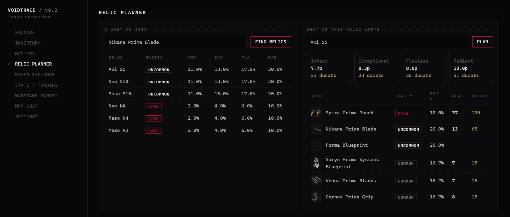

<div align="center">

<picture>
  <source media="(prefers-color-scheme: dark)" srcset="docs/wordmark-dark.svg">
  
</picture>

A Warframe companion for Windows. Relic prices on screen, your warframe.market account,
mastery and trades in one window — without Overwolf, ads or a subscription.


[How it works](#how-it-works) · [What it touches](#what-it-touches) · [Build](#build)



</div>

When a relic reward screen opens, VoidTrace reads the four cards with Windows' own OCR and
puts plat and ducat values above them, best pick marked. The relic planner works the other
way round: name the part you want and it lists the relics that drop it and what each
refinement is worth on average.

Your warframe.market account lives in the app. Sell straight from your inventory at the
cheapest online price or post a buy order, edit and hide listings, read your chats. When a
trade finishes in game, VoidTrace asks which listing it was, closes the order on the market,
logs the sale and takes it off your inventory. Your market status follows the game — in a
mission, in the orbiter, and invisible once you quit, so nobody whispers a player who left.

If you allow it to read the inventory from the game (see below), mastery, foundry, plat and
ducat history come straight from your account, no account id needed. It can start with
Windows, wait in the tray and open when Warframe does. On first start a short setup walks
through all of this and tests the parts that usually break.

## How it works

```
EE.log ──tail──▶ events ──▶ "Got rewards" ──▶ screenshot ──▶ Windows OCR ──▶ prices ──▶ overlay
                   │
                   ├─▶ login / mission end ──▶ memory read ──▶ inventory · mastery · history
                   ├─▶ mission start / end ──▶ warframe.market status
                   └─▶ trade complete ──▶ pick listing ──▶ close order · log trade · ledger

process watcher ──▶ game started ──▶ open from tray
                └─▶ game closed  ──▶ status invisible
```

Game data comes from DE's PublicExport, fetched once per content hash and cached in
`%LOCALAPPDATA%\VoidTrace`. Internal names are resolved through the recipes, so a relic reward
shows up as "Orthos Prime Blueprint" and matches warframe.market. Log patterns are tested
against a real `EE.log` and can be overridden in Settings when DE renames something. The
market side uses the v2 API and WebSocket; login still goes through v1, because third-party
OAuth isn't open yet.

## What it touches

`EE.log` is only read. The screen is captured once per relic reward screen. Nothing is sent
anywhere except to api.warframe.market (your own account) and DE's public endpoints.

> [!IMPORTANT]
> Reading the inventory from the game process is **off by default**. When you turn it on,
> VoidTrace locates the inventory document the game received at login and reads it with
> `ReadProcessMemory` — no injection, no hooks, no offsets, nothing written. Overwolf
> companions read the same data, but outside Overwolf it is not covered by DE's third-party
> policy. Your call.

## Build

```
winget install Rustlang.Rustup
winget install Microsoft.VisualStudio.2022.BuildTools --override "--wait --passive --add Microsoft.VisualStudio.Workload.VCTools --includeRecommended"
npm install
npm run tauri dev        # or: npm run tauri build
```

Warframe should run in **Borderless Fullscreen** (exclusive fullscreen hides every overlay)
with the game language set to English, and VoidTrace at the same privilege level as the game.

<details>
<summary>Checks</summary>

```
cargo test -p wfc-core                                 # log patterns, memory scanner, market types
cargo run -p wfc-core --example smoke                  # export + market + relic plan + riven grade
cargo run --release -p wfc-core --example scan_watch   # poll the running game for the inventory
```

</details>

<details>
<summary>Settings worth knowing</summary>

**Launch with Warframe** registers VoidTrace to start with Windows in the tray; closing the
window keeps it there, quit from the tray icon.

**Account id** is only needed for mastery without the inventory read: log in at warframe.com,
open `www.warframe.com/api/user-data` and copy `user_id`. Don't spam it — DE rate-limits by IP.

**Reward crop** sets where the OCR looks, in fractions of the screen; *Test OCR now* and
*Preview overlay* help tune it for non-16:9 screens.

**Intro** runs Full (8 s), Quick (2 s) or Off; Esc skips it.

</details>

<details>
<summary>Layout</summary>

```
crates/wfc-core/   export · market · ws · log · profile · memory · inventory · ocr · relic · mastery · riven · db
src-tauri/         app state, commands, tray, overlay window, event wiring
src/               Vue: intro, setup, tabs, dialogs, overlay page
```

</details>

---

<sub>VoidTrace is a fan project and not affiliated with or endorsed by Digital Extremes.
Warframe and the Lotus emblem are trademarks of Digital Extremes Ltd. · MIT licensed.</sub>
